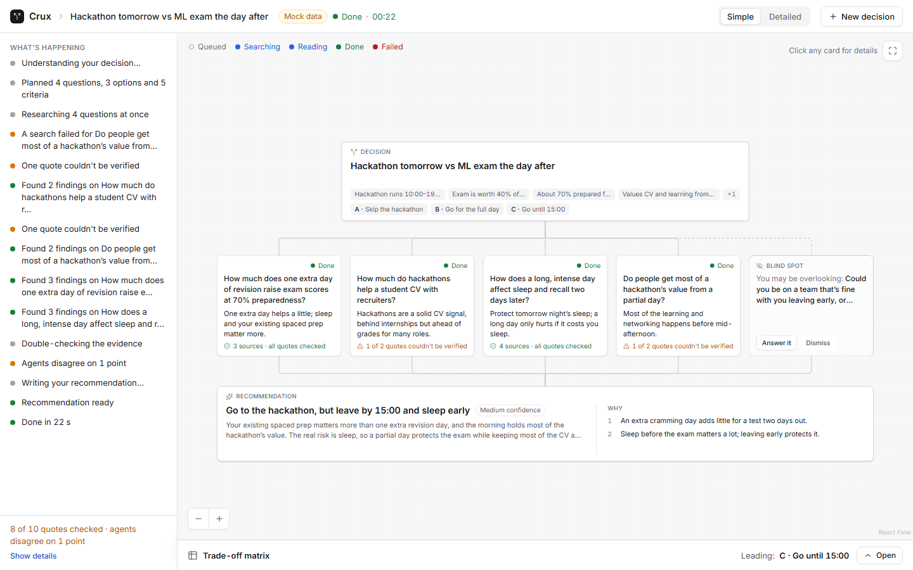
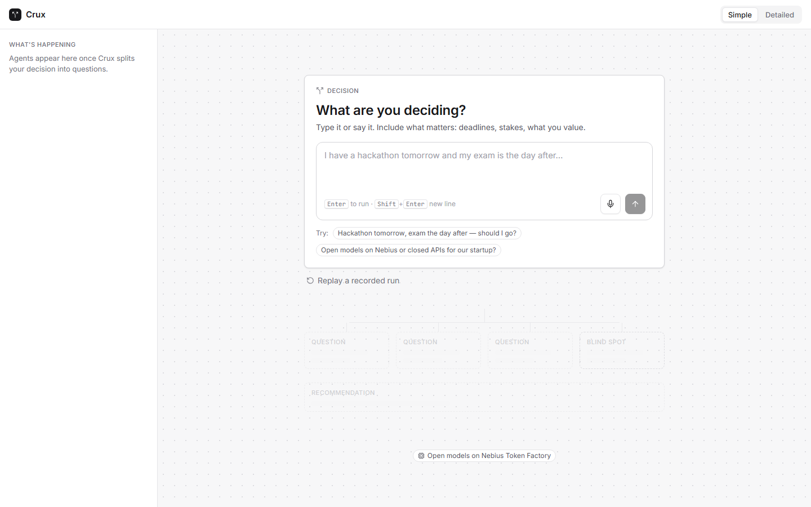
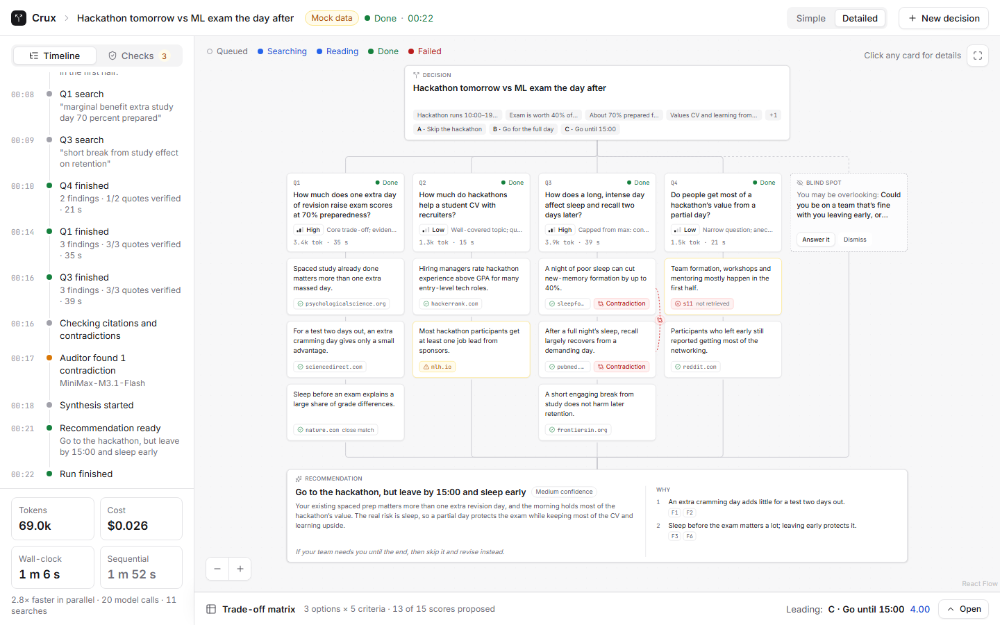
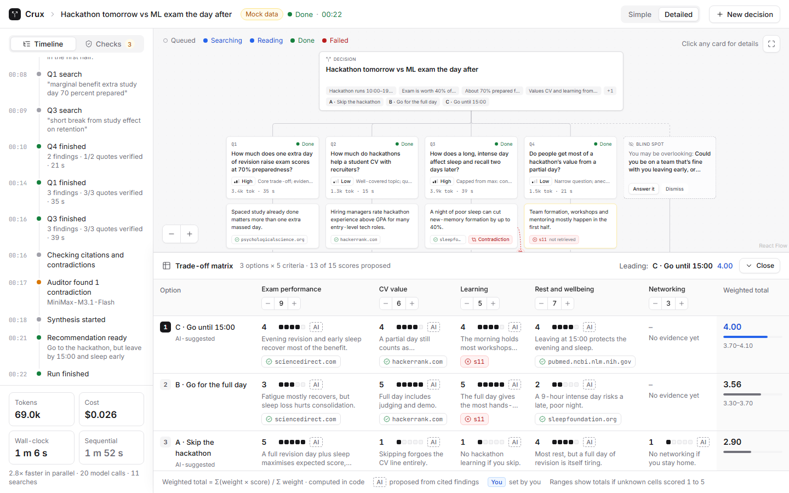

# Decision Lab

**Research what your decision actually hinges on.**

Decision Lab first interviews you about a decision you are stuck on ("I have a hackathon tomorrow and an exam the day after. Should I go?"), asks a few questions to understand your situation, works out what the decision hinges on, and sends one research agent at each question in parallel. Every quote is checked against its source in code, a second model family audits the findings for contradictions, and you get an unbiased decision brief (facts and stats for each option, never a verdict) plus a trade-off matrix whose weights you can change. Built for the Noetic × Nebius One-Day Hackathon (Imperial College London) on open models running on Nebius Token Factory.



## What it does

1. **Plan.** DeepSeek turns the decision into the facts you stated (each tied to a verbatim quote), 2-4 options, 3-5 weighted criteria, 3-4 researchable questions, and one blind spot: the thing you have probably not considered. Each question gets a reasoning effort (low / high / max) and a stated reason.
2. **Parallel research agents.** One agent per question searches the web through Tavily, reads, may search again within its effort budget, and submits findings with a verbatim quote and a source. Agents also propose 1-5 scores for each option.
3. **Citation checks.** Code verifies that each cited source was actually retrieved and that the quote appears in its text: verified, partial, or not found. Failures are shown, not hidden.
4. **Cross-family audit.** A model from a different family (MiniMax) looks for contradictions between agents. Same-model agents are not independent experts; this is the check for that.
5. **Decision brief and matrix.** DeepSeek writes a neutral brief: what the decision hinges on, the key stats for each option, and "if you value X most" lines. It never tells you what to do. The trade-off matrix (options x criteria) re-ranks instantly in code when you change a weight, so the ranking reflects your priorities, not the model's.

Follow-ups: dig deeper on any branch (the effort is bumped one level), research or answer the blind spot yourself, an effort ladder that reruns a branch at low, high and max on the same evidence so you can see what extra thinking buys, and voice input for the decision.

**Simple** mode (default) keeps everything in plain language. **Detailed** (`D`) shows findings, citations, checks, efforts, timings, tokens, cost and raw reasoning. `M` opens the matrix.

| Empty state | Detailed | Trade-off matrix |
|---|---|---|
|  |  |  |

The screenshots use the built-in mock run (`?mock=fast`), not a live run.

## Open models on Nebius Token Factory

All model calls go through one OpenAI-compatible base URL and one key.

| Model | Job | Why this model |
|---|---|---|
| DeepSeek V4.1 Flash 1017 | Planner and synthesizer at `max` reasoning; research agents at a per-branch effort (`low` / `high` / `max`) chosen by the planner | Honours `reasoning_effort`, supports tool calls with thinking on, and returns valid JSON in `json_object` mode (3/3 in the smoke test) |
| NVIDIA Nemotron 3.5 Lightning | Live one-line reasoning summaries while the other models think | 239-335 ms per call, a usable line every time in the smoke test |
| MiniMax M3.1 Flash | Cross-family contradiction audit | Different family from the researchers; flagged the planted contradiction as `direct`, valid JSON 3/3, about 0.5 s |

Outside Token Factory:

- **Tavily** for web search (Nebius is acquiring Tavily).
- **ElevenLabs Scribe v2** for speech-to-text, because Token Factory has no speech-to-text model. All reasoning stays on open models on Nebius.

## Where the models struggle (and what Decision Lab does about it)

Measured in `SMOKE.md` (three smoke runs on 24 Oct 2026) and the two recorded runs in `server/replays/`.

- **GLM-5.3-Flash is unreliable for summaries.** Even at effort `none` it spent the whole 40-token budget on hidden reasoning and returned an empty line in 3 of 6 calls (plus one truncated). We switched the summarizer to Nemotron, and the summarizer treats an empty reply as "skip".
- **Max reasoning effort is not predictable.** On the same multi-step problem, `max` used 1.3k tokens (2.4 s) in one run and 12.3k tokens (17.9 s) in another; `low` used 0.6-0.75k. On an easy puzzle, low and max were indistinguishable (28-76 tokens). Effort is honoured only when there is something to think about, so Decision Lab shows tokens and time per branch instead of implying max is always better.
- **In tool mode the agent sometimes keeps searching instead of submitting.** On turn 2 DeepSeek would call another search rather than `submit_findings`. The search budget is enforced in code per effort level, and a final salvage call forces a submission.
- **Nebius 503 outages.** Requests are retried with backoff (2, 4, 8, 12 s, honouring `Retry-After`) when nothing has streamed yet, and planning and synthesis fall back from `max` to `high` on failure.
- **Models do not reliably stay faithful to sources.** DeepSeek's non-hallucination rate is low enough that we do not trust it to quote correctly, so every quote is checked against the retrieved source text in code (verified / partial / not found). Unknown matrix cells are never treated as 0: they show "No evidence yet", and totals show a range instead. All maths (weighted totals, ranking, ranges) is done in code, not by the model.

In the two recorded runs, all quotes verified (12 of 12 and 6 of 6). The mock run in the screenshots deliberately includes a failed quote and a contradiction so the failure states are visible.

## Trust by construction

- Every finding carries a verbatim quote and a source id; code checks the source was retrieved and the quote appears in it.
- Quote status (verified / partial / not found) and "source not retrieved" are shown on the card.
- Contradictions are audited by a different model family and shown on the matrix and the Checks tab.
- Matrix numbers come from your weights and the proposed scores, computed in code. The model never does the arithmetic.
- Scores are marked "AI" (proposed from cited findings) or "You" (set by you); unknown cells read "No evidence yet" and widen the total's range.
- Each agent's effort, reason, tokens, time and cost are visible in Detailed mode.
- Recommendations are conditional and carry a confidence level; the blind spot is surfaced rather than buried.

## Run it locally

Requires Node 22 or newer (developed on Node 24). Create a `.env` in the repo root:

```dotenv
NEBIUS_API_KEY=...
TAVILY_API_KEY=...
ELEVENLABS_API_KEY=...
```

```bash
npm install && npm --prefix server install && npm --prefix web install
npm run dev
```

Open http://localhost:5173.

- `http://localhost:5173/?mock=1` runs an offline mock run (no keys, no network); `?mock=fast` plays it about 3x faster.
- Recorded replays of real runs (`server/replays/`) are listed on the empty state and play back without any API calls.
- `npm run smoke` re-runs the model smoke test; `npm test` and `npm run typecheck` cover server and web.

## Architecture

```
  web (React + React Flow)  <--- SSE events --->  server (Hono, Node)
  canvas, matrix, rail                              run manager, pipeline
                                                         |
                          +------------------------------+----------------+
                          v                              v                v
                 Nebius Token Factory                  Tavily        ElevenLabs
                 DeepSeek / Nemotron / MiniMax      (web search)   (Scribe v2 STT)
```

The server streams a typed event log per run over SSE; the web app is a reducer over that log, which is also what makes recorded replays possible.

- `shared/` the contract both sides import: event and API types, matrix maths, pricing.
- `server/` pipeline (planner, agents, synthesis, follow-ups), Nebius client with limiter and retries, Tavily, quote and contradiction checks, stats, speech-to-text, replays.
- `web/` canvas graph, Simple / Detailed shell, inspector, matrix, mock run.

## Cost

Measured from the final stats event of each recorded run, in Nebius tokens:

| Run | Findings | Quotes verified | Model calls | Searches | Cost | Wall-clock | Speed-up vs sequential |
|---|---|---|---|---|---|---|---|
| Hackathon vs exam | 12 | 12 of 12 | 31 | 15 | $0.038 | 69 s | 2.4x |
| Startup: open vs closed models | 6 | 6 of 6 | 16 | 15 | $0.030 | 55 s | 2.8x |

Expect about $0.03-0.04 per decision in Nebius tokens (about $0.07 including a full set of follow-ups), plus about 30 Tavily credits (30 in each recorded run). Nearly all of the spend is DeepSeek (about $0.037 of $0.038 in the first run); Nemotron summaries cost under $0.001.

## Docs

[`implementation.md`](implementation.md) is the full build spec: product decisions, architecture, model routing, shared contract and UX.
